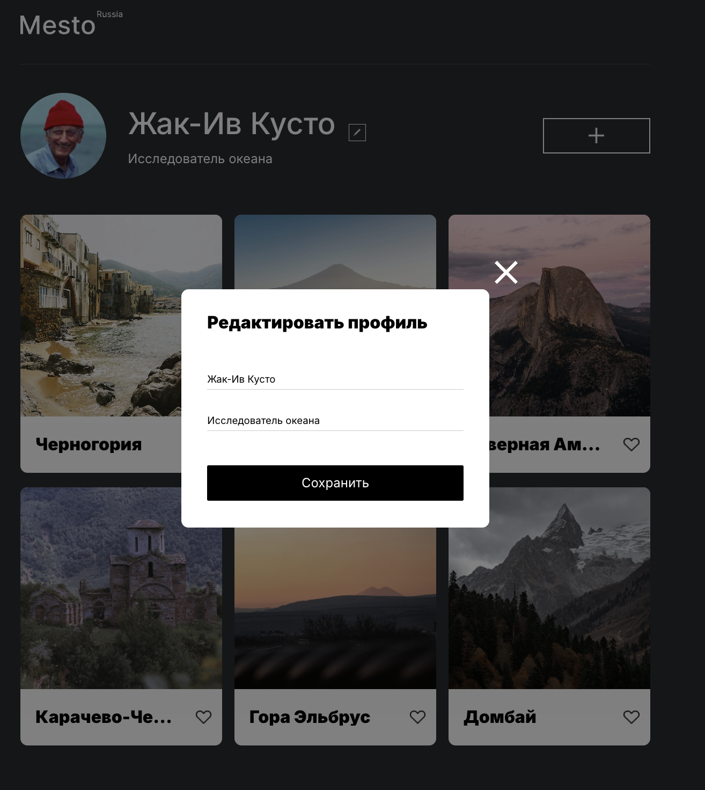
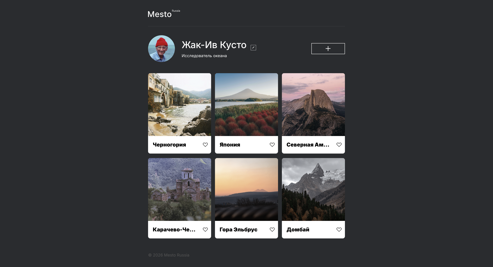
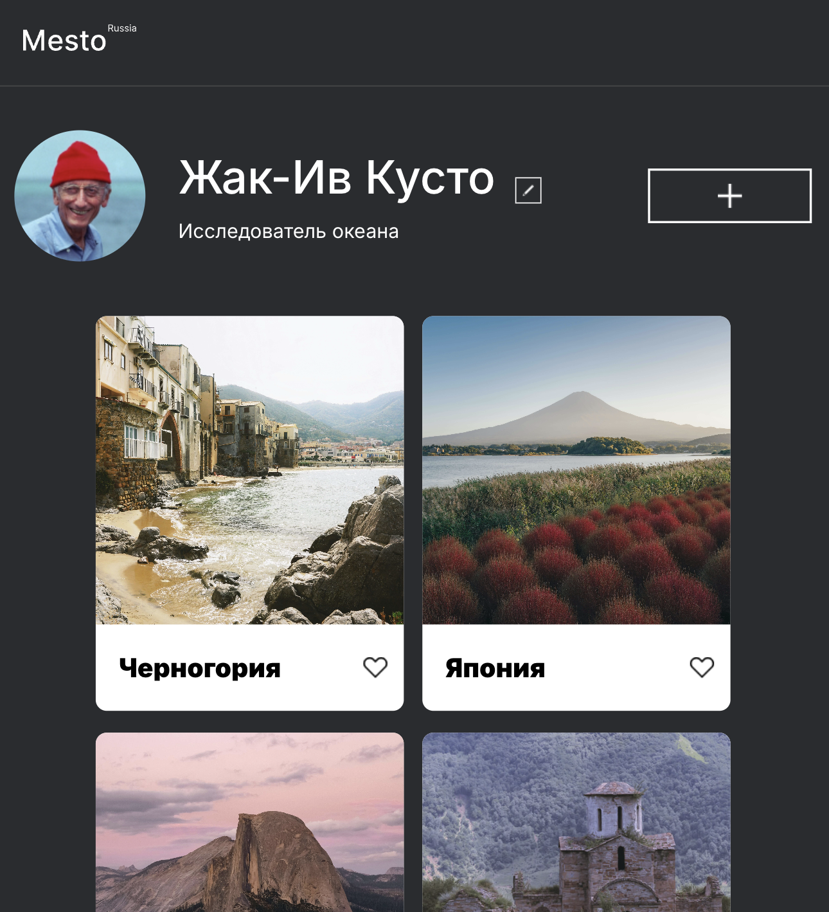
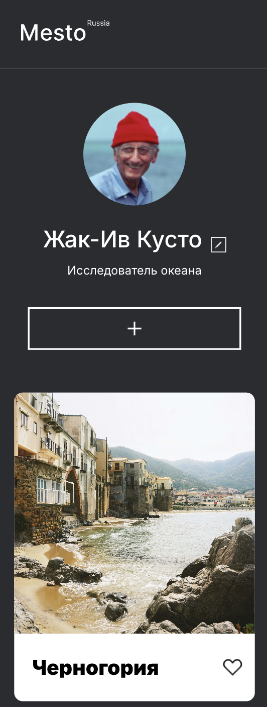

# Проект: Место

## Верстка адаптивного сайта с применением JS

**Демо:** [открыть сайт](https://tankievmagomed.github.io/mesto/)

Это интерактивная страница, куда можно добавлять фотографии, удалять их и ставить лайки, а её реализация демонстрирует освоенные возможности HTML CSS, JS (реализована форма корректировки имени и информации о пользователе ).

### Технологии:

- HTML 5
- CSS 3
- JS
- Flexbox
- Grid Layout
- Media
- БЭМ nested

## Планы по доработке

- Поэкспериментировать с анимациями при перестроении элементов.
- Добавить функционал по добавлению фотографий
- Добавить функционал для возможности ставить лайк фотографиям
