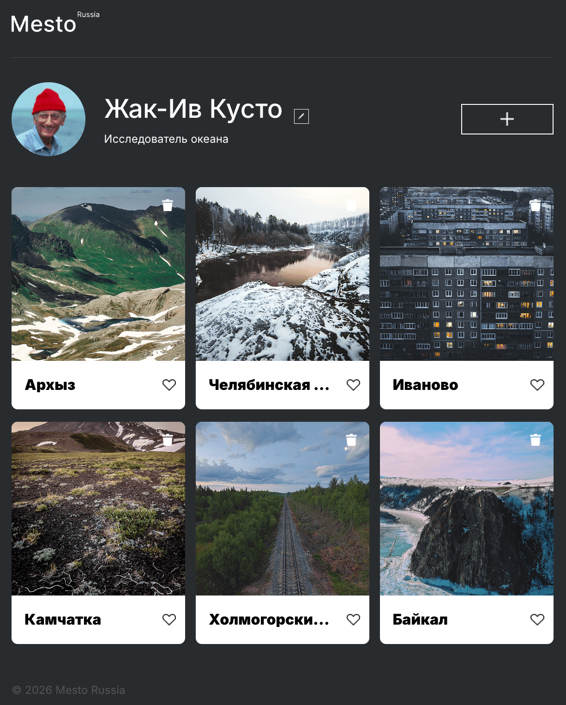
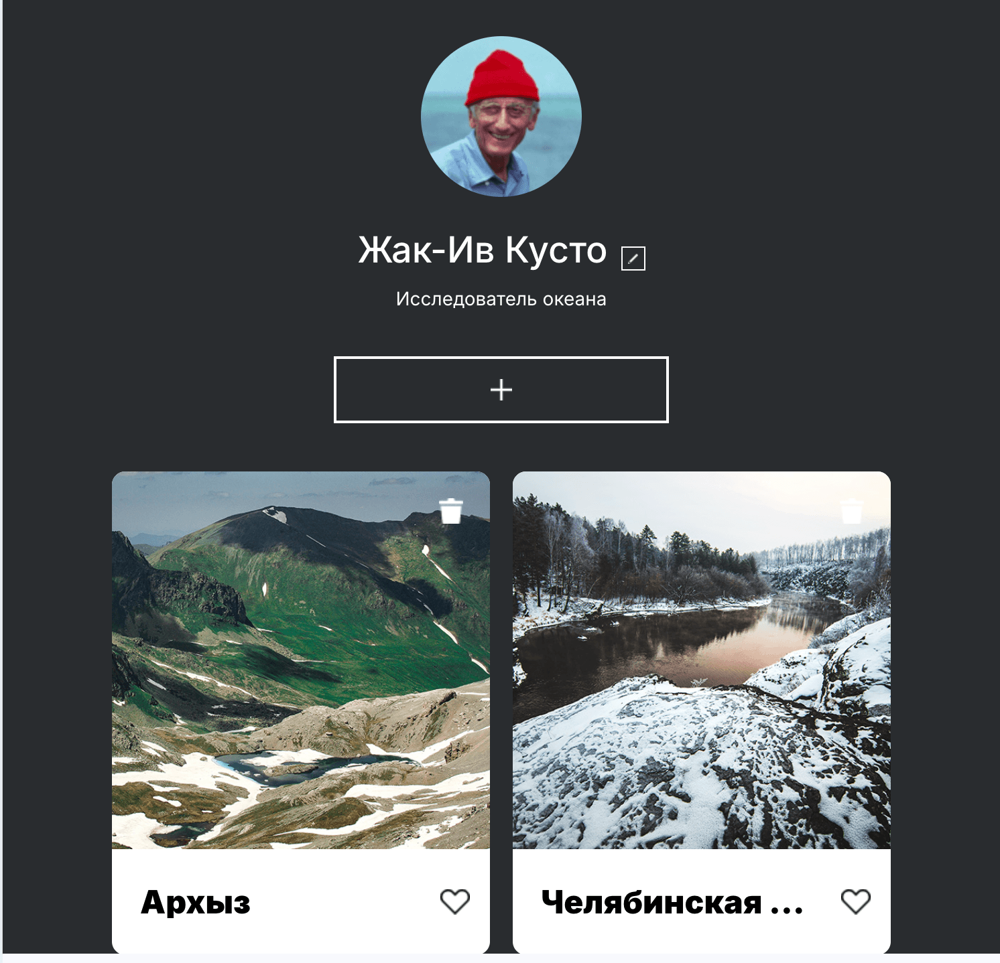
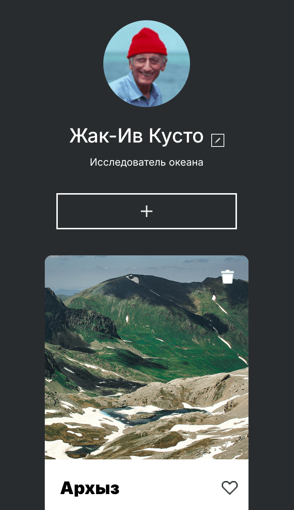
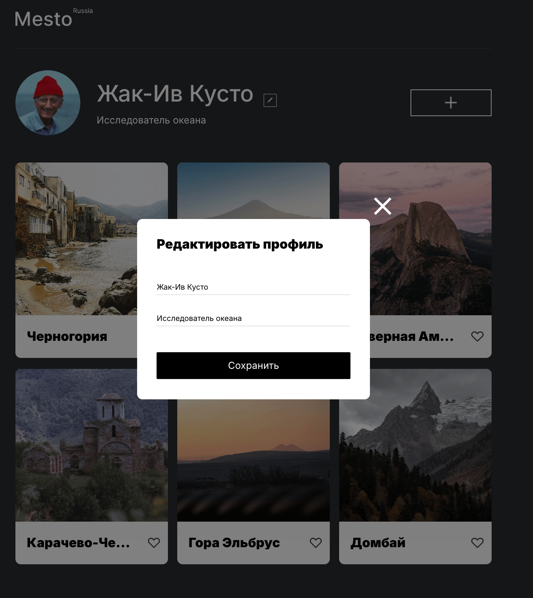
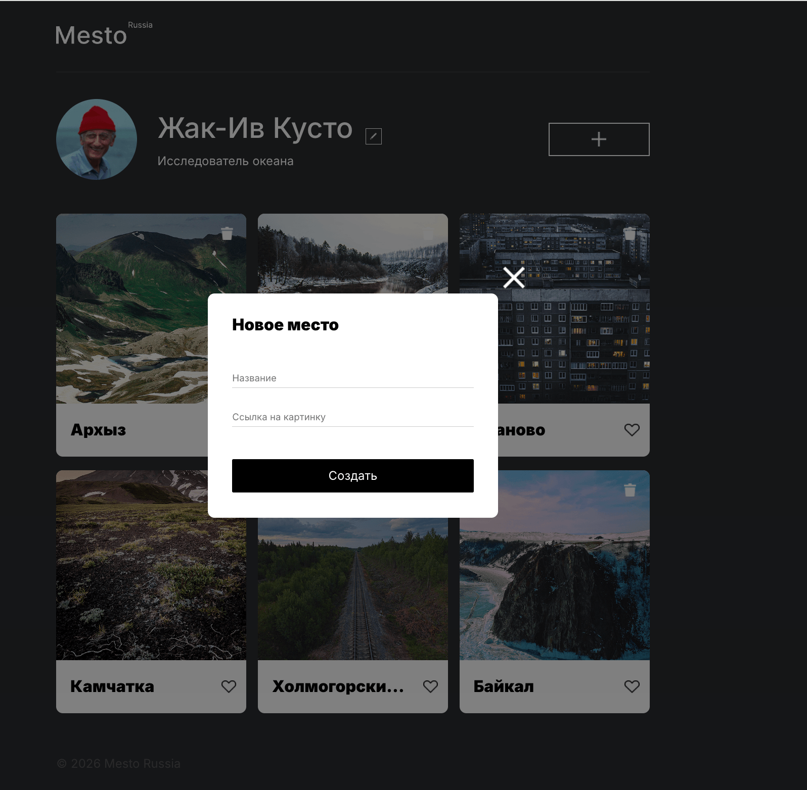
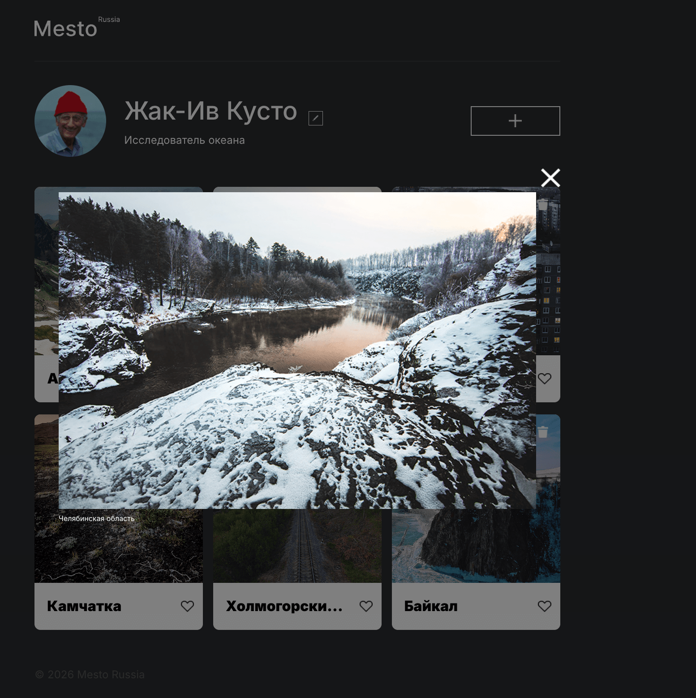

# Проект: Место

## Верстка адаптивного сайта с применением JS

**Демо:** [открыть сайт](https://tankievmagomed.github.io/mesto/)

Это интерактивная страница, куда можно добавлять фотографии, удалять их и ставить лайки, а её реализация демонстрирует освоенные возможности HTML, CSS, JS (реализована форма корректировки имени и информации о пользователе, форма добавления новой карточки, открытие карточки во весь экран)

### Технологии:

- HTML 5
- CSS 3
- JS
- Flexbox
- Grid Layout
- Медиазапросы
- БЭМ nested
- Template
- Работа с DOM

